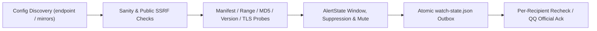

<h1 align="center">AstrBot Resource Monitor</h1>

<p align="center">
  <code>Python 3.10+</code> · <code>aiohttp&gt;=3.14.5</code> · <code>AstrBot Plugin (astrbot_plugin_resource_watch)</code> · <a href="LICENSE"><code>AGPL-3.0-only</code></a>
</p>

<p align="center">
  <a href="README.md">简体中文</a> | <strong>English</strong>
</p>

<p align="center">
  <a href="https://astrbot-resource-monitor.cbnv.me/en/">Online Docs</a> · <a href="repo-docs/README.md">Engineering Guide (zh)</a>
</p>

**A scheduled resource-distribution route probe plugin for AstrBot**: it verifies remote config entrypoints, asset manifests, HTTP `Range` slices, MD5 checksums, hot-update archives, and TLS certificate expiration using the same rules as distribution clients, then delivers debounced alerts through a persistent outbox. The plugin is strictly read-only, pins connections to public IPs only, never alters upstream configs, and does not collect host CPU or memory telemetry.

## Core Capabilities & Data Flow

- **Live Config Discovery & Safe Fallback**: Supports remote `endpoint` discovery (`entry_url` + backup `entry_urls`) and static local `mirrors` lists with zero hardcoded fallback endpoints; when primary discovery fails, non-expired cached snapshots yield `unknown=True` diagnostic context only—never green verdicts.
- **Ten Content & Protocol Probes**: Looks beyond HTTP 200 to catch config drops/version regressions, majority manifest consensus, HTTP `206` Range support, 32-hex MD5 chunk rotation (7-day coverage), streaming full-package verification, and daily TLS expiry (`<14d` P2 / `<3d` P0).
- **Noise Suppression & QQ Official Ack**: `AlertState` combines `M-of-N` sliding failure windows, two-tier `suppress_key` filtering, mute retention, per-recipient stale checks (`_discard_stale`), and viewer-bound `/线路 通知` + admin `/线路 确认` acknowledgment on `qq_official` platforms.
- **Shared-Host Guardrails**: `PublicResolver` pins validated public IPs across redirects (`allow_redirects=False`), enforces a `64 MiB` buffer cap, disables cookies/env proxies, rate-limits `/线路` via `CommandGate`, and sanitizes untrusted text with `render.safe()`.
- **Explicit Boundaries & Lock Separation**: Fast (`300s`) and slow (`3600s`) cycles run under independent async locks so large hot-package digests never stall quick checks; long-term SLA stats, host metrics, and auto-remediation remain strictly out of scope.

## Capabilities & Explicit Non-Goals

| Area | What AstrBot Resource Monitor Delivers | Explicit Non-Goals & Hard Bounds |
| --- | --- | --- |
| Probes & Discovery | Live `endpoint`/`mirrors` discovery running 10 `P0/P1/P2` probes (manifests, `206` Range, MD5 chunks, hot archives, TLS expiry) | **Never** collects host CPU/RAM/disk telemetry or acts as a long-term SLA archive |
| Security & Alerting | Public IP pinning across redirects (`64 MiB` cap), `M-of-N` debounce, two-tier suppression, `render.safe()`, QQ Official ack | **Blocks** LAN/loopback targets & `trust_env`; chat `/线路 test` forces `allow_heavy=False` skipping full archives |
| Isolation & SPIs | Separate fast/slow locks plus offline-testable `Source` & `HttpClient` SPIs | **Never** auto-switches CDN routes or edits upstream configs; bundles zero default URLs |



Each cycle discovers active mirrors dynamically, filters SSRF/config mutations, dispatches independent fast and slow probes, persists converged notifications to disk first, and re-validates alert state before sending to every target session.

## Quick Start

Install under AstrBot's plugin directory using package-relative imports and run the offline test suite (`entry_url` or `mirrors` is mandatory; there is no built-in default source):

```sh
git clone https://github.com/CyberNova2333/astrbot-resource-monitor.git data/plugins/astrbot_plugin_resource_watch
cd data/plugins/astrbot_plugin_resource_watch
pip install -r requirements.txt
python3 -m unittest discover -s tests -t . -v
```

Fill in `entry_url` (or `mirrors`) and target `notify.sessions` UMOs inside AstrBot WebUI, restart the plugin, and send `/线路 状态` in an authorized chat (if adapting `config.example.json`, update legacy `fire_after`/`recover_after` keys to `fire_after_failures`, `fire_window`, and `recover_after_successes`). Other operating modes and verification paths:

| Mode / Scenario | Summary | Documentation |
| --- | --- | --- |
| Standalone JSON config | Set `RESOURCE_WATCH_CONFIG` env var (valid WebUI settings take precedence) | [Config Matrix](docs-site/en/docs/configuration.md) |
| Static `mirrors` list | Supply `["MirrorA=https://a.example.test/"]` without a central endpoint (`线路速率` stays unknown) | [Source Modes](docs-site/en/docs/configuration.md#config-source-modes-endpoint-vs-mirrors) |
| Interactive `/线路` commands | Supports `status`, `test`, `config`, `mute`, `unmute`, `coverage`, `notifications`, `ack` | [Command Overview](docs-site/en/docs/index.md#chat-commands-overview) |
| QQ Official adapters | Requires OpenID UMOs; marks targets `submitted` pending admin `/线路 确认` | [QQ Official Notes](docs-site/en/docs/configuration.md#qq-official-adapter-notes) |
| Offline checks & endpoint guard | Run `unittest`, `compileall`, and `check-no-endpoints.py` before committing | [Code Map & Verification](docs-site/en/docs/architecture.md) |

## Pre-Adoption FAQ

- **Does it monitor the AstrBot host's CPU, RAM, or disk?**
  No. Every probe inspects external HTTP/HTTPS distribution configs, manifests, byte slices, hot-update archives, and TLS certificates rather than host telemetry.

- **Can the plugin automatically switch CDN routes or repair broken configs?**
  No. Observation and write authority are strictly separated, and long-term SLA uptime dashboards are intentionally out of scope.

- **Can it probe private/LAN endpoints or tunnel requests through environment proxies?**
  No. `PublicResolver` and TLS validation block loopback/private/reserved IP ranges and explicitly disable `trust_env`.

- **Will running `/线路 测 <mirror>` download full multi-hundred-MB hot-update packages?**
  No. Chat-triggered probes force `allow_heavy=False` under a shared `"heavy"` cooldown, preventing repeat messages from amplifying origin bandwidth.

- **Is there a built-in default endpoint if nothing is configured yet?**
  No. Missing `entry_url`/`mirrors` causes initialization to fail fast with a clear error rather than faking healthy status.

## Reading Paths

| Reader Goal | Docs Site (`docs-site/en/`) | Engineering Guide (`repo-docs/`) |
| --- | --- | --- |
| Install, configure options & troubleshoot setup | [Getting Started](docs-site/en/docs/index.md) · [Config Matrix & FAQ](docs-site/en/docs/configuration.md) | [Sources & Degraded Mode (zh)](repo-docs/modules/sources-and-degraded.md) |
| Inspect 10 probes, security gates & extension APIs | [Contracts & Extensions](docs-site/en/docs/contracts.md) · [API & Component Reference](docs-site/en/api-reference/index.md) | [Probes & Rotation (zh)](repo-docs/modules/probes-and-rotation.md) · [Security & Gates (zh)](repo-docs/modules/security-and-gates.md) |
| Trace execution flow, code layout & ADRs | [Architecture & Decisions](docs-site/en/docs/architecture.md) | [One Real Run (zh)](repo-docs/walkthroughs/one-real-run.md) · [Code Map (zh)](repo-docs/code-map.md) |
| Audit evidence coverage & project glossary | — | [Glossary (zh)](repo-docs/glossary.md) · [Source Evidence (zh)](repo-docs/references/source-evidence.md) · [Quality Review (zh)](repo-docs/references/quality-review.md) |
| Review contributor hooks & security policy | — | [CONTRIBUTING.md](CONTRIBUTING.md) · [SECURITY.md](SECURITY.md) · [Guardrails Guide](guardrails/README.md) |

## License & Safety Rules

- **License & Compatibility**: Licensed under the [GNU Affero General Public License v3.0](LICENSE) (`AGPL-3.0-only`) as a read-only extension plugin for [AstrBot](https://astrbot.app/). Persist `runtime.state_dir` across restarts to retain deduplication windows and mute state.
- **Endpoint Hygiene**: Zero real endpoints, group IDs, or tokens are distributed; examples exclusively use RFC 6761 `example.test`.
- **Verification & Disclosure**: All changes must pass `python3 tools/check-no-endpoints.py --verbose` before push; see [CONTRIBUTING.md](CONTRIBUTING.md) and [SECURITY.md](SECURITY.md).

- **Additional Terms & Assets**: Pursuant to Section 7 of GNU AGPLv3, Covered Material is governed by [`LICENSE-ADDITIONAL_TERMS-zh-CN.md`](LICENSE-ADDITIONAL_TERMS-zh-CN.md) (English reference translation: [`LICENSE-ADDITIONAL_TERMS-en.md`](LICENSE-ADDITIONAL_TERMS-en.md); the Simplified Chinese Full Text prevails), setting forth provenance, modification marking, anti-impersonation, conditional permissive-extension exemptions, and project identifier boundaries; engineering guidance is provided in [`IMPLEMENTATION-GUIDE.zh-en.md`](IMPLEMENTATION-GUIDE.zh-en.md), and the unified four-section manifest of human authors, AI assistants, upstream/third-party code, and independent artwork, fonts, and project identifiers is maintained in [`ASSETS_LICENSES.md`](ASSETS_LICENSES.md). Authorization for additional requirements and for Sections 9.5–9.6 additional permissions is verified separately per copyright holder; third-party or upstream materials remain governed by their existing valid licenses.
