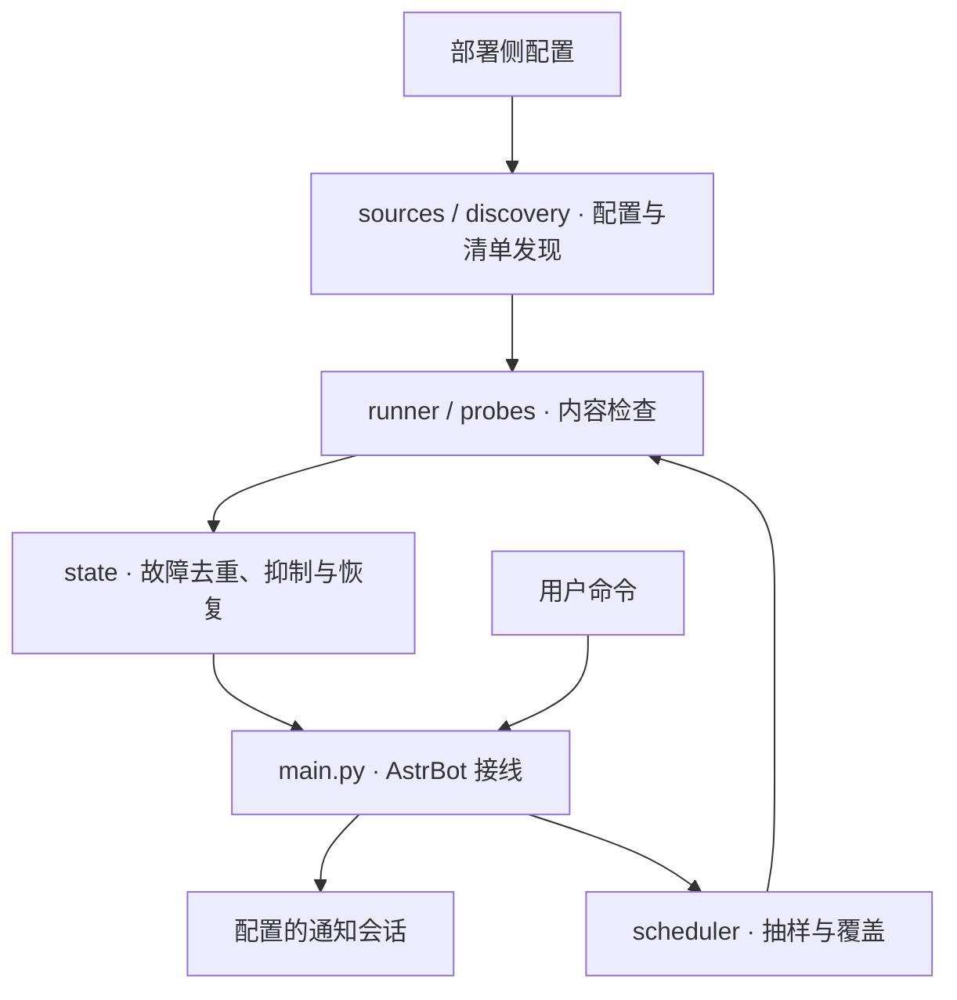

# AstrBot Resource Monitor 📡

> **按客户端内容校验规则检测资源线路，并通过 AstrBot 发送故障与恢复通知。**

检查配置、清单、Range、块 MD5、热更包和证书等信息，识别“HTTP 200 但内容不可用”的故障。插件只负责观察与通知，不自动改配置或切换线路。

<a id="-架构与职责"></a>

**阅读导航**

[🏛️ 架构与职责](#section-1) · [🚀 安装与配置](#section-2) · [⚙️ 常用命令](#section-3) · [🧪 验证](#section-4) · [⚙️ 配置来源与通知边界](#section-5) · [📜 许可](#section-6)

---

<a id="section-1"></a>

## 🏛️ 架构与职责



| 路径 | 职责 |
|---|---|
| `main.py` | AstrBot 注册、命令与通知接线 |
| `watch/sources.py` / `discovery.py` | 配置源适配与清单发现 |
| `watch/probes.py` / `runner.py` | 探针与单轮检查 |
| `watch/scheduler.py` / `state.py` | 抽样覆盖、故障去重、恢复与静音 |
| `tests/` | 使用假响应的离线判据测试 |

<a id="-安装与配置"></a>

<a id="section-2"></a>

## 🚀 安装与配置

1. 将仓库放入 AstrBot 的 `data/plugins/`，运行依赖见 [requirements.txt](requirements.txt)。
2. 在插件 WebUI 选择配置源：`entry_url` 指向配置文档，或 `mirrors` 直接提供线路表。
3. 配置 `notify.sessions`，用 `/线路 状态` 检查结果；多实例可用 `notify.prefix` 区分。

本地配置模板见 [config.example.json](config.example.json)，字段定义见 [_conf_schema.json](_conf_schema.json)。真实地址、通知会话与凭据只保存在部署侧。

开发护栏的下载地址与名单 API 同样由部署侧提供：安装使用 `HOOK_PACKAGE_URL`（兼容 `PKG_URL_DEFAULT`），名单查询使用 `CNB_API` 或安装目录策略的 `cnb_api`。源码不提供默认端点；缺少必要配置时安装或名单刷新会报错。具体流程见 [护栏部署说明](guardrails/README.md)。

<a id="-常用命令"></a>

<a id="section-3"></a>

## ⚙️ 常用命令

| 命令 | 用途 |
|---|---|
| `/线路 状态` | 检查结果与覆盖概况 |
| `/线路 测 <线路名>` | 手动检查指定线路 |
| `/线路 配置` | 配置摘要 |
| `/线路 静音 30m` / `/线路 取消静音` | 维护窗口 |
| `/线路 覆盖率` | 最近七天的块校验覆盖 |

内容判据取自线路清单；缺少阈值或热更声明时保持“未判定”。旧配置只能提供诊断线索，不能据此判定当前线路健康。配置层次、探针与通知限制见 [详细参考](docs/PROBES.md)。

<a id="-验证"></a>

<a id="section-4"></a>

## 🧪 验证

```sh
python3 tools/check-no-endpoints.py
python3 -m unittest discover -s tests -t .
python3 -m compileall -q watch main.py
```

测试无需 AstrBot 或真实线路。协作和提交要求见 [CONTRIBUTING.md](CONTRIBUTING.md)、[AGENTS.md](AGENTS.md) 与 [CLAUDE.md](CLAUDE.md)。代码采用 [GPLv3](LICENSE)。


<a id="section-5"></a>

## ⚙️ 配置来源与通知边界

| 来源 | 负责内容 |
|---|---|
| 插件本地配置 | 入口、通知会话、实例前缀与运行开关 |
| 线上配置与清单 | 线路、待检文件及客户端使用的判断依据 |
| 本地状态 | 连续故障、已通知状态、恢复与静音窗口 |

部署后先用状态命令检查配置是否完整，再验证故障与恢复通知。离线判据测试不会向真实会话发消息，也不能证明机器人平台的会话权限已经就绪。

<a id="section-6"></a>

## 📜 许可

代码采用 [GPLv3](LICENSE)。真实线路、会话 ID 与凭据不随源码或示例分发。
