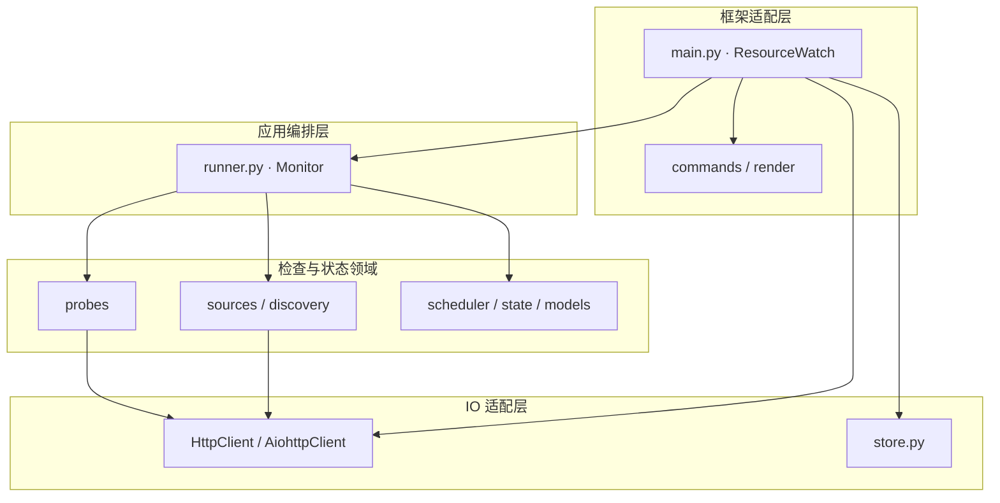

# AstrBot Resource Monitor 📡

> **按客户端内容校验规则检测资源线路，并通过 AstrBot 发送故障与恢复通知。**

检查配置、清单、Range、块 MD5、热更包和证书等信息，识别“HTTP 200 但内容不可用”的故障。插件只负责观察与通知，不自动改配置或切换线路。

<a id="-架构与职责"></a>

**阅读导航**

[🏛️ 分层代码架构](#section-1) · [🚀 安装与配置](#section-2) · [⚙️ 常用命令](#section-3) · [🧪 验证](#section-4) · [⚙️ 配置来源与通知边界](#section-5) · [📜 许可](#section-6)

---

<a id="section-1"></a>

## 🏛️ 分层代码架构

AstrBot 依赖集中在 `main.py`。`Monitor` 组织一轮检查，来源适配和探针通过 `HttpClient` 获取数据，调度与告警状态单独维护；判据和状态模块无需导入机器人框架。

图中展示主要代码依赖：实线箭头指向被调用或被依赖的模块，虚线表示实现或生成关系；数据读写另用连线文字标明。



| 层次 | 源码入口 | 职责与边界 |
|---|---|---|
| 框架适配层 | [main.py · ResourceWatch](main.py) | 注册命令、定时任务、HTTP 实例与会话通知。 |
| 框架适配层 | [commands / render](watch/commands.py) | 解析操作、组织状态文本和通知文本。 |
| 应用编排层 | [runner.py · Monitor](watch/runner.py) | 协调发现、抽样、探针结果和告警状态。 |
| 检查与状态领域 | [sources / discovery](watch/sources.py) | 将配置源、清单和版本文档转换成检查输入。 |
| 检查与状态领域 | [probes](watch/probes.py) | 判定内容、Range、摘要与一致性等结果。 |
| 检查与状态领域 | [scheduler / state / models](watch/state.py) | 维护抽样覆盖、故障状态与恢复通知对象。 |
| IO 适配层 | [HttpClient / AiohttpClient](watch/http.py) | 提供可替换 HTTP 能力，测试使用假响应实现。 |
| IO 适配层 | [store.py](watch/store.py) | 负责本地 JSON 状态读写。 |

<a id="-安装与配置"></a>

<a id="section-2"></a>

## 🚀 安装与配置

1. 将仓库放入 AstrBot 的 `data/plugins/`，运行依赖见 [requirements.txt](requirements.txt)。
2. 在插件 WebUI 选择配置源：`entry_url` 指向配置文档，或 `mirrors` 直接提供线路表。
3. 配置 `notify.sessions`，用 `/线路 状态` 检查结果；多实例可用 `notify.prefix` 区分。

本地配置模板见 [config.example.json](config.example.json)，字段定义见 [_conf_schema.json](_conf_schema.json)。真实地址、通知会话与凭据只保存在部署侧。

插件内部使用包内相对导入，可由 AstrBot 按插件包加载，无需把插件目录加入 `PYTHONPATH`。更新时保留完整的 `main.py` 与 `watch/` 目录。

插件统一使用 `astrbot_plugin_resource_watch` 标识，入口类为 `ResourceWatch`，默认 User-Agent 为 `resource-watch/1.0`。WebUI 配置缺失或不可用时，可通过环境变量 `RESOURCE_WATCH_CONFIG` 指定本地 JSON 配置文件；有效的 WebUI 配置优先。

配置源的数组、线路字段与地址必须符合声明类型，数值必须有限且在支持范围内；无效配置会明确报错，并在指定本地配置文件时尝试回退。旧入口写法、单个入口字符串和 WebUI 的“名称=地址”线路写法仍可使用。

从旧安装迁移时，先停用旧插件，将原 WebUI 配置复制到新标识对应的配置中，并将启动脚本中的配置文件环境变量更新为 `RESOURCE_WATCH_CONFIG`；不提供旧标识别名。将配置中显式保存的 `runtime.user_agent` 更新为 `resource-watch/1.0`，或清空以采用默认值。保留原 `runtime.state_dir` 及其中的 `watch-state.json`，可继续沿用故障去重和静音状态。旧版覆盖记录没有线路维度，升级后重新累计覆盖；清单内容或线路地址变化也会使相关旧覆盖失效。迁移后只启用一份插件，执行 `/线路 状态` 验证配置。

更新插件时同步安装 `requirements.txt`，最低运行依赖为 `aiohttp 3.14.5`（需要 Python 3.10 或更新版本），避免已有环境继续使用受已披露漏洞影响的旧依赖。HTTP 与证书检查只连接公网地址：配置入口、线路、DNS 结果和每次重定向都受此限制，内网监控不属于当前支持范围。

项目历史已统一为功能性命名。已有克隆应先另存未提交的改动，再重新克隆，逐项迁移本地配置；不要合并或推回旧历史。提交重写会改变提交 ID，历史提交保留原作者与时间，并由维护者重新进行 SSH 签名。

开发护栏的下载地址与名单 API 同样由部署侧提供：安装使用 `HOOK_PACKAGE_URL`（兼容 `PKG_URL_DEFAULT`），名单查询使用 `CNB_API` 或安装目录策略的 `cnb_api`。源码不提供默认端点；缺少必要配置时安装或名单刷新会报错。具体流程见 [护栏部署说明](guardrails/README.md)。

### QQ 官方机器人

支持 AstrBot 的 QQ 官方 WebSocket、Webhook 适配器，以及群聊和 C2C 私聊。先在 AstrBot 中配置并启用机器人；新会话或重启后，先在目标会话与机器人对话，让适配器取得会话上下文。群聊按 AstrBot 的唤醒配置 @ 机器人后发送命令。

将该会话实际的完整 `unified_msg_origin`（UMO）复制到 `notify.sessions`。UMO 首段是 AstrBot 中配置的机器人 ID，可能是自定义名称，不能直接替换成平台类型；QQ 官方平台使用 OpenID，不能填写日常 QQ 号或群号。默认只在通知会话或 `command.allow_sessions` 中响应命令，填完用 `/线路 状态` 验证命令可达。管理员命令依赖 AstrBot 的管理员配置，其中应填写该平台实际的发言用户 ID（QQ 官方为用户 OpenID），而非日常 QQ 号。

QQ 官方消息以纯文本输出，链接会省略，P0 的全体提及降级为文字提示。主动通知是否可用取决于 AstrBot 适配器声明的能力，以及机器人权限、额度与会话上下文；未声明支持主动消息时，通知保留供查询。

主动调用未抛出异常时，只记录该通知已向此会话尝试提交，不视为送达确认，也不再每隔一轮自动重发；明确发送异常才继续重试。即使框架内部仅记日志而没有实际发出，通知仍可用 `/线路 通知` 查询。该命令显示本会话最早一条待处理通知，查看不会清除；管理员本人查看后执行 `/线路 确认`，只确认自己刚才在这个会话查看的那一条，再次查询可查看下一条。插件重启后需重新查询再确认，其他会话的通知不受影响。

<a id="-常用命令"></a>

<a id="section-3"></a>

## ⚙️ 常用命令

| 命令 | 用途 |
|---|---|
| `/线路 状态` | 检查结果与覆盖概况 |
| `/线路 测 <线路名>` | 手动检查指定线路 |
| `/线路 配置` | 配置摘要 |
| `/线路 静音 30m` / `/线路 取消静音` | 维护窗口 |
| `/线路 覆盖率` | 最近七天各线路与分块组合的校验覆盖 |
| `/线路 通知` | 查看本会话最早一条待处理通知，查看不会清除 |
| `/线路 确认` | 管理员确认自己上次在本会话查看的那一条通知 |

内容判据取自线路清单；缺少阈值或热更声明时保持“未判定”。旧配置只能提供诊断线索，不能据此判定当前线路健康。配置层次、探针与通知限制见 [详细参考](docs/PROBES.md)。

<a id="-验证"></a>

<a id="section-4"></a>

## 🧪 验证

```sh
python3 tools/check-no-endpoints.py
python3 -m unittest discover -s tests -t .
python3 -m compileall -q watch main.py
```

测试无需 AstrBot 或真实线路。协作和提交要求见 [CONTRIBUTING.md](CONTRIBUTING.md)、[AGENTS.md](AGENTS.md) 与 [CLAUDE.md](CLAUDE.md)。代码采用 [GPLv3](LICENSE)。

未安装运行依赖时，连接器相关测试会明确跳过；安装 `requirements.txt` 后可运行完整测试。CI 单独安装依赖执行连接层回归，响应与连接仍使用离线替身。地址守卫同时检查工作区与待推送提交的实际内容，避免“先加入再删除”把地址留进历史。


<a id="section-5"></a>

## ⚙️ 配置来源与通知边界

| 来源 | 负责内容 |
|---|---|
| 插件本地配置 | 入口、通知会话、实例前缀与运行开关 |
| 线上配置与清单 | 线路、待检文件及客户端使用的判断依据 |
| 本地状态 | 连续故障、已生成通知、待发队列、恢复与静音窗口 |

部署后先用状态命令检查配置是否完整，再验证故障与恢复通知。离线判据测试不会向真实会话发消息，也不能证明机器人平台的会话权限已经就绪。

快巡检与慢速整包检查分开调度，手动检查产生的告警同样进入持久化发送队列。普通平台发送失败只重试尚未成功的会话；QQ 官方平台另行保存尝试提交记录，保留未确认通知供查询，具体流程见上文。静音期间暂缓发送与待处理通知展示，已恢复的旧故障不补发。队列保证可恢复重试，但平台接收与本地保存记录之间若发生断电，仍可能重复送达。P0 全体提及使用平台消息组件，实际可用性由适配器与会话权限决定，QQ 官方降级为文字提示。

<a id="section-6"></a>

## 📜 许可

代码采用 [GPLv3](LICENSE)。真实线路、会话 ID 与凭据不随源码或示例分发。
